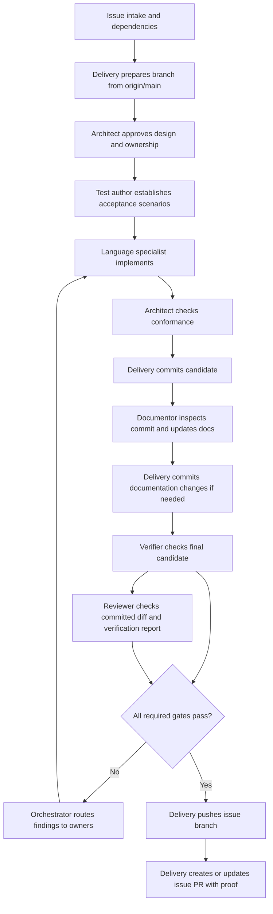

# Issue delivery workflow

This workflow supports **E01-S03** (epic dependencies: none). Its acceptance criterion is that tasks identify owned files, public APIs, tests, and prohibited cross-module changes. `AGENTS.md` and `ARCHITECTURE.md` remain the domain and module contract sources. The agents add issue-level ownership and evidence handoffs; they do not implement the simulator or establish scientific fidelity.

## Configuration and use

`.codex/config.toml` enables agents and caps concurrent subagents at three, excluding the primary session. Ten standalone profiles under `.codex/agents` inherit the parent model, reasoning effort, permissions, provider, and integrations. Skills live under `.codex/skills`; relative symlinks in `.agents/skills` expose them to repository skill discovery, including sessions launched in subdirectories. No global configuration is changed.

Open a fresh Codex session in this trusted project after installing the configuration. Check `/skills` for `issue-orchestrator` and the other role skills. Ask for the orchestrator explicitly, for example:

```text
Use $issue-orchestrator and the orchestrator agent to deliver GitHub issue <issue URL>.
Use origin/main as the base and carry it through push and PR creation.
```

Overrides must be explicit:

```text
Use $issue-orchestrator to deliver <issue URL>, branching from origin/release-next.
```

For a narrower task:

```text
Use the code_reviewer agent and $issue-code-review to review <base SHA>..<candidate SHA>.
Return findings locally.
```

For local-only work, say so in the request; it overrides the default issue-delivery push/PR steps. A request to deliver an issue through this workflow authorizes its scoped branch, commits, push, and PR. It does not authorize merging, creating a repository, releases, or unrelated messages. GitHub access uses connected tools where sufficient, with Git/gh for unsupported operations. Never persist credentials in the repository.

These files guide agents; they are not enforcement hooks or independent read-only sandboxes. Parent and managed permissions still apply. If runtime delegation/discovery is unavailable, report that limitation rather than pretending specialist agents ran.

The configuration follows the official [subagent schema](https://learn.chatgpt.com/docs/agent-configuration/subagents?surface=app) and [skill discovery rules](https://learn.chatgpt.com/docs/build-skills#where-codex-loads-local-skills).

## Roles and order

| Agent | Skill | Ownership and output |
| --- | --- | --- |
| `orchestrator` | `issue-orchestrator` | Issue intake, dependencies, bounded assignments, gate results, corrective iterations |
| `delivery` | `issue-delivery` | Branch/worktree, scoped staging, commits, push, PR and evidence assembly |
| `architect` | `issue-architecture` | Read-only preimplementation design and postimplementation conformance |
| `test_author` | `issue-bdd-tests` | Assigned tests/fixtures, acceptance mapping, meaningful red evidence |
| `rust_implementor` | `issue-rust-implementation` | Assigned Rust production files and local validation |
| `python_implementor` | `issue-python-implementation` | Assigned Python training/validation and approved integration files |
| `web_implementor` | `issue-web-implementation` | Assigned TypeScript/Svelte files and approved API integration |
| `verifier` | `issue-verification` | Independent checks and evidence artifacts; no product/test edits |
| `code_reviewer` | `issue-code-review` | Read-only review of committed diff, findings and disposition |
| `technical_documentor` | `issue-technical-documentation` | Assigned documentation, commit impact, Mermaid and ADR updates |

Only the orchestrator delegates workflow stages. Workers return to it rather than spawning another orchestrator. Assign multiple implementors only for actual cross-language work; serialize shared types and overlapping files. Send verification and review results to delivery as well as the orchestrator.



Delivery defaults to `codex/issue-<number>-<slug>` from a freshly fetched `origin/main`. An explicit base/branch overrides that default. Unrelated index and worktree changes are preserved; use an isolated worktree if needed. Missing remote/base, issue ambiguity, conflicting branch history, or authentication failure blocks dependent delivery steps with a specific explanation. Do not silently substitute a local base or run the repository publishing script.

Explicit-path staging does not remove preexisting unrelated index entries. Inspect the entire index and prefer an isolated worktree before committing. For an established continuation, a scoped `git commit --only -- <owned paths>` is allowed only when those paths contain no unrelated edits; verify the unrelated index entries remain intact afterward.

New project commits use the repository-local Git identity associated with `nthompson-bitwarden` as both author and committer, with no coding-agent attribution in metadata or messages. Delivery checks effective identities, signs every commit (including merges and amendments), verifies signatures locally, and checks GitHub's commit API after push for `verified: true`, `reason: valid`, and the expected account attribution. Local signing alone is insufficient. Preserve legitimate third-party authorship. Missing signing capability or failed GitHub verification blocks completed delivery; published-history repair requires explicit user authorization and an exact-SHA lease.

## Handoff and evidence contract

Use this compact handoff for every assignment and result. `pending` or `not applicable` is explicit when a candidate or public change does not yet exist.

```text
Issue URL / number and repository:
Story ID, acceptance criteria, dependencies and their status:
Base ref and SHA / candidate SHA:
Owned crates and files:
Public APIs / stored schemas / compatibility impact:
Prohibited cross-module changes:
Tests / fixtures / seeds / expected behavior:
Findings / decisions / limitations:
Status and next owner:
```

The test author uses Given/When/Then names or comments in the existing ecosystem framework. Do not add a BDD framework for syntax alone. A compilation failure is not a demonstrated behavioral failure; record it separately and rerun when interfaces exist. For documentation/config-only work, parser/discovery checks and scenario exercises can replace artificial red tests, with an explicit rationale.

Verifier evidence is tied to a committed candidate and follows this format:

| Criterion or check | Test / command / scenario | Status | Result and evidence reference |
| --- | --- | --- | --- |
| Exact issue criterion or required check | Reproducible invocation and test IDs | PASS, FAIL, BLOCKED, or NOT RUN | Observed result, output/artifact reference, limitation |

Attach base/candidate SHAs, tool/environment versions, and relevant fixture/source versions, seeds, units, provenance, uncertainty, and benchmark hardware. A PASS means the stated check ran successfully. FAIL means it ran and contradicted expectations. BLOCKED identifies a prerequisite failure. NOT RUN means there is no execution evidence. Required gaps block a ready PR; optional suggestions and checks must be labeled as such, with rationale.

Always run `cargo fmt --all --check`, `cargo clippy --workspace --all-targets -- -D warnings`, and `cargo test --workspace`. Add actual ecosystem-specific checks once UI/training code is introduced. User-facing features need a human-reviewable demonstration. Simulation-critical changes need complexity and representative benchmark evidence. Baseline calibration, independent scientific validation, and external acceptance remain distinct gates whenever the issue requires them.

Documentation changes are committed before final verification/review. A later fix requires documentation-impact reassessment, architectural reassessment when relevant, renewed affected verification, final required checks, and review of the final committed diff. Carry forward an unchanged check only with verifier justification and its source SHA. Never label stale evidence as a fresh run. Evidence may be attached in the PR or referenced as an artifact; it need not be committed, avoiding a self-referential commit hash.

## PR and failure handling

The ready PR includes:

- Problem, resulting behavior, and `Closes #<number>` for the completed issue.
- Story ID, architecture/public-contract decisions, and compatibility or migration notes.
- Final verified/reviewed SHA and acceptance evidence table, with reproducible commands and artifacts.
- Architecture conformance, code-review disposition, and documentation updates or no-change rationale.
- Relevant benchmark, provenance, uncertainty, and limitations; explicitly identify optional unrun checks.

Delivery checks for an existing PR on the same repository/head branch before creating one. Push normally to the issue branch; never force-push or merge by default. If a network request has an uncertain result, inspect remote state before retrying. If push succeeds but PR creation fails, report the pushed branch/SHA and PR blocker. Never describe partial delivery as complete.

## Validation scenarios for E01-S03

Use read-only tabletop exercises or isolated fixtures; do not create a live PR solely to test configuration.

| Given / When | Expected outcome |
| --- | --- |
| A new issue with a reachable origin/main | Delivery records fetched base SHA and creates the issue branch before edits |
| An explicit alternative base | Delivery uses and records that base |
| Unrelated staged or untracked changes overlap assigned paths | Preserve them and isolate issue work |
| A required test fails or tooling is missing | FAIL or BLOCKED evidence; no ready PR |
| A reviewer finds a swallowed error or self-asserting test | Route to implementor/test author; commit fixes and renew verification/review |
| A documentor updates an API guide after candidate commit | Commit docs before final SHA verification/review |
| An existing issue PR or uncertain PR-create response | Inspect and update the existing PR; avoid duplicate creation |
| No origin/main or issue identity | Report the precise blocker without inventing a base or issue |
| An explicitly authorized unborn-repository setup | Local initial commit is allowed; future issue delivery still requires origin/main |
| A machine-derived email, agent identity, or agent co-author trailer | Correct identity/message before committing; use the repository-local Git identity associated with `nthompson-bitwarden` for new project commits |
| Signing fails or the configured key is unavailable | Block the commit; never disable signing or substitute an agent key |
| A locally valid signature has GitHub reason `no_user` or `unknown_key` | Block completed delivery; fix email/key association and obtain authorization before rewriting published history |

Configuration validation must check TOML parsing, unique agent names, required fields, skill frontmatter, all role/skill links, and symlink resolution. Validate runtime discovery separately from static parsing; do not imply that either proves live GitHub delivery.

See the [initial setup validation record](AGENT-SETUP-VALIDATION.md) for executed checks and explicit limitations.
